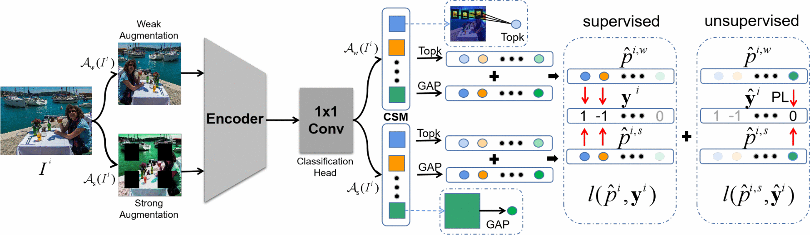

# Saliency Regularization for Self-Training with Partial Annotations

[](https://openaccess.thecvf.com/content/ICCV2023/html/Wang_Saliency_Regularization_for_Self-Training_with_Partial_Annotations_ICCV_2023_paper.html)
[](https://wangshouwen.github.io/SR/)

Official PyTorch implementation of "Saliency Regularization for Self-Training with Partial Annotations"

> Partially annotated images are easy to obtain in multi-label classification. However, unknown labels in partially annotated images exacerbate the positive-negative imbalance inherent in multi-label classification, which affects supervised learning of known labels. Most current methods require sufficient image annotations, and do not focus on the imbalance of the labels in the supervised training phase. In this paper, we propose saliency regularization (SR) for a novel self-training framework. In particular, we model saliency on the class-specific maps, and strengthen the saliency of object regions corresponding to the present labels. Besides, we introduce consistency regularization to mine unlabeled information to complement unknown labels with the help of SR. It is verified to alleviate the negative dominance caused by the imbalance, and achieve state-of-the-art performance on Pascal VOC 2007, MS-COCO, VG-200, and OpenImages V3.

## Pipeline


## Installation

```shell
pip install -r requirements.txt
```

Training and evaluation use one GPU. The MS-COCO and VOC loaders call `wget` and `unzip`.

## Data Preparation

Final folder structure should be

```
data_root_dir
├── VOCdevkit/VOC2007               # Pascal VOC 2007: downloaded on the first run
├── files/VOC2007                   # its label csv files: written on the first run
├── MSCOCO_2014                     # MS-COCO 2014: downloaded on the first run
│   ├── train2014, val2014, annotations
│   └── train_anno.json, val_anno.json, category.json   # written on the first run
└── VG_100K                         # VG-200
    ├── images/*.jpg
    ├── train_list_500.txt
    ├── test_list_500.txt
    └── vg_category_200_labels_index.json
```

Labels follow `+1` present, `-1` absent, `0` unknown; unknown labels are left out of the loss.
`--sample_partial_param` sets the fraction of labels kept as known (0.1 to 0.9).

## Training and Evaluation

```shell
python train.py --data_root_dir ${data_root} --dataset VOC2007 --image_size 448 --epochs 25 -b 32 \
    --model_name ResNet101 --model_ema --sample_partial_mode global_random --sample_partial_param 0.1 \
    --save_dir ${save_dir}
```

| Dataset | `--dataset` | `--image_size` | `--epochs` | `-b` |
|---|---|---|---|---|
| Pascal VOC 2007 | `VOC2007` | 448 | 25 | 32 |
| MS-COCO | `COCO2014` | 448 | 20 | 32 |
| VG-200 | `VG` | 448 | 20 | 32 |

Each run writes `checkpoint_best.pth` to `--save_dir`. To evaluate it, repeat the dataset flags and add:

```shell
python train.py --data_root_dir ${data_root} --dataset VOC2007 --image_size 448 -b 32 \
    --model_name ResNet101 --model_ema --evaluate --resume ${save_dir}/checkpoint_best.pth
```

`--resume` without `--evaluate` continues training from a checkpoint.

## Inference

```shell
python predict.py --checkpoint ${save_dir}/checkpoint_best.pth --images my_photos/ --classes classes.txt
```

`--classes` lists one class name per line in training order (Pascal VOC names are used when it is omitted
and the model has 20 classes). The model settings are read from the checkpoint.

## Citation
If you find it helpful, please consider citing
```bibtex
@inproceedings{wang2023saliency,
  title     = {Saliency Regularization for Self-Training with Partial Annotations},
  author    = {Wang, Shouwen and Wan, Qian and Xiang, Xiang and Zeng, Zhigang},
  booktitle = {Proceedings of the IEEE/CVF International Conference on Computer Vision (ICCV)},
  pages     = {1611--1620},
  year      = {2023}
}
```
